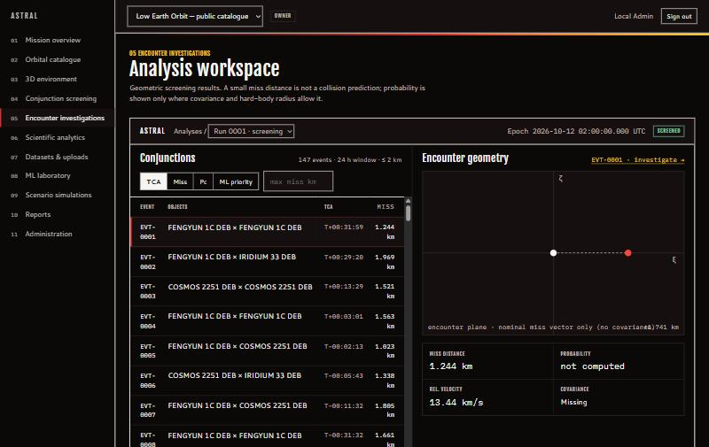
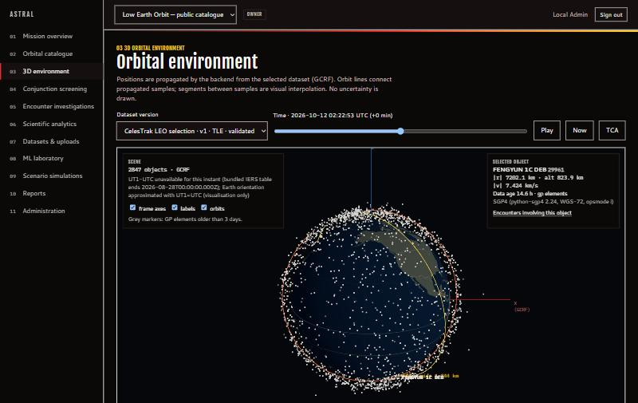
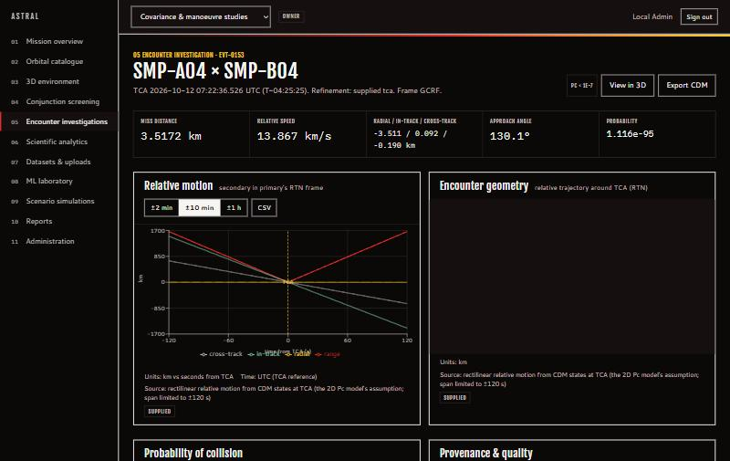

<div align="center">

# ASTRAL

### Advanced Space Traffic Risk Assessment & Analysis Laboratory

A full-stack platform for satellite conjunction screening, encounter analysis, collision-probability assessment and 3D orbital visualisation, built around traceable, reproducible results.


</div>



---

## Contents

- [What ASTRAL does](#what-astral-does)
- [Walkthrough](WALKTHROUGH.md) — plain-language tour and demo script
- [Screenshots](#screenshots)
- [How it works](#how-it-works)
- [Quick start](#quick-start)
- [Using the application](#using-the-application)
- [Data sources](#data-sources)
- [Architecture](#architecture)
- [Scientific approach](#scientific-approach)
- [Testing and validation](#testing-and-validation)
- [Project structure](#project-structure)
- [Documentation](#documentation)
- [Status and limitations](#status-and-limitations)
- [License](#license)

---

## What ASTRAL does

ASTRAL takes in orbital data for thousands of satellites and debris objects, predicts where they will be, finds pairs that will pass close to each other, and helps an analyst understand each close approach. Every number it shows can be traced back to its input data, algorithm and configuration.

| Area | Capability |
|---|---|
| **Data ingestion** | TLE, CCSDS OMM (KVN / XML / JSON / CSV), OEM and CDM, plus documented CSV/JSON state-vector formats. Each upload is validated record by record and stored as an immutable, SHA-256-hashed dataset version. |
| **Live data** | Optional import of public orbital data from CelesTrak, recorded with full fetch provenance. |
| **Propagation** | SGP4 for element sets (verified against the published Vallado test set), Hermite interpolation for supplied ephemerides, and a two-body + J2 numerical model for manoeuvre studies. |
| **Conjunction screening** | Catalogue-scale search with a mathematically conservative proximity bound, k-d-tree candidate selection and Brent-method refinement of the time of closest approach (TCA). |
| **Encounter analysis** | Miss distance, relative velocity, RTN components, approach angle, encounter-plane geometry and relative-motion plots. |
| **Collision probability** | 2D Foster/Alfano method with a Monte Carlo cross-check. Computed only when both covariances and a hard-body radius are available; otherwise reported explicitly as `INSUFFICIENT_DATA_FOR_PC`. |
| **Avoidance manoeuvres** | For any close approach, simulates 60 possible pushes (5 directions × 4 sizes × 3 timings), charts the predicted distance for each, ranks the most efficient ones and re-checks any option against every other object. |
| **ML prioritisation** | Experimental model that ranks encounters for review. Separate from, and never a substitute for, the physical analysis. |
| **3D visualisation** | Interactive Earth with every tracked object, orbit tracks, time scrubbing and encounter highlighting. |
| **Reporting** | PDF, CSV and JSON reports with input hashes and software versions; CCSDS OEM and CDM export. |
| **Platform** | Authentication, per-project roles, audit log, rate limits, background job queue, Docker deployment. |

---

## Screenshots

| Orbital environment (2,847 tracked objects) | Encounter investigation |
|---|---|
|  |  |

---

## How it works

```
 Upload / CelesTrak ──► Validate ──► Immutable dataset version (hashed)
                                              │
                                              ▼
                         Background job: propagate ─► screen ─► refine TCA
                                              │
                                              ▼
              Encounters ─► geometry ─► probability (when covariance exists)
                                              │
                     ┌────────────────────────┼────────────────────────┐
                     ▼                        ▼                        ▼
              3D & charts           Manoeuvre comparison       PDF / CSV / JSON / CCSDS
```

1. **Ingest.** Files are parsed, checked (checksums, units, frames, time systems, duplicates, stale data, covariance validity) and saved as a fixed version. Corrections are proposed, never applied silently.
2. **Analyse.** A screening job propagates every object over the chosen window, finds all pairs that come within the threshold, and pins down each closest approach to sub-millisecond precision.
3. **Investigate.** Each encounter shows its geometry, data age, propagation method and, when inputs allow, its probability of collision.
4. **Report.** Results export with the hashes and versions needed to reproduce them.

---

## Quick start

### Option A — Docker (PostgreSQL, API and worker)

```bash
git clone https://github.com/Aryan-Is-Here/ASTRAL-Web-Application.git
cd ASTRAL-Web-Application
cp .env.example .env          # set ASTRAL_SECRET_KEY and POSTGRES_PASSWORD
docker compose up -d --build
docker compose exec -e ASTRAL_ADMIN_PASSWORD='choose-a-long-password' api \
  python -m astral.cli create-admin --email you@example.org
```

Open `http://localhost:8000` (behind a TLS proxy in production — see [DEPLOYMENT.md](DEPLOYMENT.md)).

### Option B — Local development

Requirements: **Python 3.11** and **Node.js 20+**. No GPU or cloud services are needed.

**Backend**

```bash
cd backend
python -m venv .venv
source .venv/bin/activate            # Windows: .venv\Scripts\activate
pip install -r requirements.lock.txt
python -m astral.cli migrate
ASTRAL_ADMIN_PASSWORD='choose-a-long-password' python -m astral.cli create-admin --email you@example.org
python -m astral.cli seed-live --email you@example.org    # real CelesTrak data (needs internet)
python -m astral.cli seed-demo --email you@example.org    # sample CDMs with covariance
python -m astral.cli train-ml --activate                  # optional experimental model
uvicorn astral.main:app --port 8000
```

**Frontend** (in a second terminal)

```bash
cd frontend
npm ci
npm run dev
```

Open **http://localhost:5173** and sign in. Interactive API documentation is at **http://localhost:8000/docs**.

---

## Using the application

| Page | What you can do |
|---|---|
| **At a glance** | Four headline numbers, the Track → Find → Act story and the five closest passes. |
| **3D view** | Smooth playback (60×–1200×) of hundreds of objects; click to follow one; open any close approach at its moment. |
| **Close approaches** | Every predicted close pass with distance, timing, a picture of the pass, distance-over-time chart and data provenance. |
| **Avoidance manoeuvres** | Predicted effect of 60 possible pushes, the most efficient options in plain words, and a full check against every other object. |
| **Run a search** | Start a new search or check a conjunction message; see progress and the screening funnel. |
| **Charts** | Timeline, distance vs speed, data freshness, data quality, uncertainty and search speed — each with a "what this shows" note and CSV export. |
| **Tracked objects · Data sources · Reports** | Browse objects, load or upload data, export PDF/CSV/JSON reports. |
| **AI ranking (beta) · Settings · How it works** | Experimental ranking model, system settings, and the in-app guided tour. |

A plain-language walkthrough with a demo script is in [WALKTHROUGH.md](WALKTHROUGH.md); step-by-step usage is in [USER_GUIDE.md](USER_GUIDE.md).

---

## Data sources

| Source | Used for |
|---|---|
| **CelesTrak** (public GP element sets) | Real catalogue screening. `seed-live` loads the ISS and other stations, the brightest satellites, and the Iridium-33, Cosmos-2251 and Fengyun-1C debris clouds (≈2,850 objects). |
| **Your own files** | Any supported format through the upload page or the API. |
| **Sample conjunction messages** (`seed-demo`, `examples/`) | Demonstrating covariance-based probability and manoeuvre comparison. Public element sets carry no covariance, so probability needs CDMs or ephemerides that include it. |

Public element sets are suitable for screening and research. They are not an authoritative source for operational decisions.

---

## Architecture

```
frontend/   React 18 · TypeScript (strict) · Vite · three.js (react-three-fiber) · Recharts · TanStack Query
backend/
  astral/core/      Scientific core — parsers, time & frames, propagation, screening, encounter geometry,
                    covariance, probability, manoeuvres. No web dependencies; usable as a library.
  astral/services/  Datasets, job queue & worker, reports, data providers, auth, audit, object storage
  astral/api/       FastAPI routers, security middleware, role-based access
  astral/ml/        Features, training, evaluation, inference
  astral/db/        SQLAlchemy models; Alembic migrations
```

- **Database:** PostgreSQL in production, SQLite for local development.
- **Jobs:** database-backed queue (`SELECT … FOR UPDATE SKIP LOCKED`) with in-process or separate worker processes; progress, cancellation, retries for transient failures only.
- **Reproducibility:** every analysis references an immutable input snapshot whose hash is checked before use, plus a configuration hash and the versions of every algorithm and library.

Details: [ARCHITECTURE.md](ARCHITECTURE.md).

---

## Scientific approach

- **Time and frames:** UTC/TAI/TT/GPS/TDB via ERFA; TEME, GCRF, EME2000 and ITRF, with tested conversions and explicit handling of leap seconds and Earth-orientation data.
- **Screening completeness:** if two objects truly pass within the threshold, the nearest grid step is guaranteed to flag them, because of a bound on relative acceleration. This is verified against brute-force sampling.
- **Probability of collision:** only with both covariances and a hard-body radius. Assumptions are stated in every result, and applicability warnings are attached.
- **Honest outputs:** a small miss distance is reported as a geometric result, never as a collision prediction. Missing inputs produce an explicit status instead of a guessed number.

Methods, equations and the full assumptions register: [SCIENTIFIC_METHODS.md](SCIENTIFIC_METHODS.md).

---

## Testing and validation

| Suite | Tests |
|---|---|
| Scientific reference (SGP4 vs. Vallado 2006, frame conversions, probability vs. closed forms, screening vs. brute force, integrator invariants) | 56 |
| Unit (parsers, covariance, geometry, manoeuvres) | 21 |
| Integration (full HTTP workflow on a real database) | 4 |
| Security (isolation, CSRF, lockout, limits, injection, audit) | 13 |
| Machine learning (determinism, leakage guards, metrics, fallbacks) | 8 |
| Frontend (design tokens, formatting, probability badges) | 7 |

```bash
cd backend && python -m pytest -q
cd frontend && npm test && npm run typecheck && npm run lint
```

**Performance** (Intel Core i5-11260H laptop, 24-hour window, 30 s step): 800 objects in 6.0 s, 2,000 objects in 11.6 s. On real CelesTrak data, a 24-hour screen of 2,847 objects found 147 close approaches under 2 km in under a minute.

Full results, tolerances and their justification: [VALIDATION_REPORT.md](VALIDATION_REPORT.md).

---

## Project structure

```
.
├── backend/              Python package, tests, Alembic migrations, requirements
├── frontend/             React application
├── examples/             Example input files for every supported format
├── docs/                 Design reference, screenshots, benchmark results
├── Dockerfile            Production image (API + built frontend)
├── docker-compose.yml    PostgreSQL + API + worker
└── *.md                  Documentation (see below)
```

---

## Documentation

| Document | Contents |
|---|---|
| [ARCHITECTURE.md](ARCHITECTURE.md) | Components, data flow, design decisions |
| [SCIENTIFIC_METHODS.md](SCIENTIFIC_METHODS.md) | Algorithms, conventions, assumptions register |
| [DATA_FORMATS.md](DATA_FORMATS.md) | Supported formats, validation rules, exports |
| [API.md](API.md) | Authentication, endpoints, error codes, examples |
| [WALKTHROUGH.md](WALKTHROUGH.md) | Plain-language tour, demo script, jury Q&A |
| [USER_GUIDE.md](USER_GUIDE.md) | Step-by-step use of every view |
| [DEPLOYMENT.md](DEPLOYMENT.md) | Local, Docker and production setup |
| [OPERATIONS.md](OPERATIONS.md) | Monitoring, backup/restore, upgrades, incident response |
| [SECURITY.md](SECURITY.md) | Threat model and controls |
| [VALIDATION_REPORT.md](VALIDATION_REPORT.md) | Executed tests, reference comparisons, benchmarks |
| [ML_CARD.md](ML_CARD.md) | Model purpose, training, evaluation, limits |
| [MODEL_AND_DATA_LIMITATIONS.md](MODEL_AND_DATA_LIMITATIONS.md) | Known modelling and data limitations |
| [ROADMAP.md](ROADMAP.md) | Planned work |
| [LICENSES.md](LICENSES.md) | Third-party licences |
| [CHANGELOG.md](CHANGELOG.md) | Release history |

---

## Status and limitations

ASTRAL is **research and evaluation software**. It has not been independently qualified for operational spacecraft-safety decisions, and results should be reviewed by a qualified analyst. Main open items:

- comparison of probability results against NASA CARA reference cases;
- covariance propagation (probability is currently computed at CDM-supplied TCAs);
- OIDC single sign-on.

See [ROADMAP.md](ROADMAP.md) and [MODEL_AND_DATA_LIMITATIONS.md](MODEL_AND_DATA_LIMITATIONS.md).


